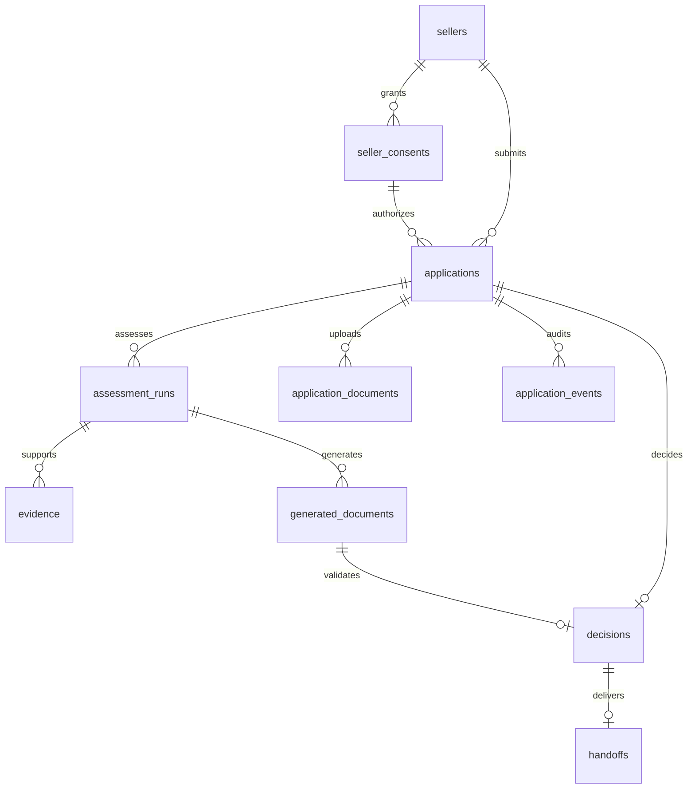

# Dữ liệu và bằng chứng

## Nguồn chuẩn database

Ngày 31/10/2026, người dùng chọn [database/riverbank-mini.dbml](../database/riverbank-mini.dbml) làm thiết kế database cho bản mini. File giữ nguyên nội dung đã cung cấp. Đây là DBML PostgreSQL để đọc/vẽ ERD, **chưa phải SQL migration và chưa được chạy trên database**.

Schema này thay mô tả cũ về `cases`, `seller_shops`, `seller_feature_snapshots`, `case_events` và `loan_terms_versions`. Không tạo thêm những bảng đó chỉ để khớp tài liệu cũ. Những đường dẫn `api/` là vị trí triển khai dự kiến, hiện repo chưa có backend.

Phạm vi đã chốt: một marketplace, một ngân hàng đối tác, VND, một shop cho mỗi seller record, một hồ sơ cho mỗi lô và một quyết định cuối của người ngân hàng trên mỗi hồ sơ. Không có bảng mật khẩu, tài khoản tín dụng, giải ngân, kế toán hay thu nợ. Cấu hình ngân hàng/sản phẩm và policy đã xác nhận nằm trong artifact cấu hình có version.

## Quy ước kiểu dữ liệu

| Khái niệm | Contract mini |
|---|---|
| Định danh | UUID do ứng dụng tạo cho seller/application/run/evidence/document/decision/handoff/consent |
| Shop | `sellers.external_shop_ref`, unique. Không có `shop_id` hoặc bảng nhiều shop riêng |
| Tiền ở cột SQL | `numeric(18,2)`, xử lý chính xác bằng Decimal, không qua float |
| Tiền trong JSONB | Chuỗi decimal, ví dụ `"90000000.00"` trong lịch chi, snapshot và kết quả |
| Kỳ hạn / tuần | Integer, mốc tuần từ 0. Hard cap theo policy và schema ứng dụng |
| Thời gian | `timestamptz`, ứng dụng cung cấp UTC. SQL có default now() trong thiết kế |
| Khóa ghi | `applications.version_no`, kiểm và tăng trong transaction thay đổi state |
| Audit ID | `application_events.event_id` là bigint tự tăng, không phải UUID |
| Hash | SHA-256 trên bytes JSON canonical. Quy tắc canonicalization phải khóa trước triển khai |

Các fixture nghiệp vụ hiện dùng số nguyên VND. DB cho phép hai chữ số thập phân không tự quyết định việc API nhận phần lẻ VND hoặc lịch trích chia theo đồng hay phần trăm đồng. Cần chốt quy tắc này trước ENG-01 và kiểm giữ nguyên kết quả FX-A/B. Định dạng tiền ở API được khóa riêng, không tự suy ra từ kiểu SQL.

## Contract kế hoạch và định danh API

Các trường kế hoạch map vào `applications`: seller UUID, consent UUID, lot_value, cash_on_hand, sell_weeks, requested_amount, supplier_schedule và sanitized_note. Tổng lịch trả phải bằng lot_value, tuần chi không vượt kỳ bán. Kiểm hard cap và guard trước ANALYZING. Note đầu vào phải được chặn/làm sạch trước khi lưu sanitized_note hoặc gửi outbound.

Public route `/v1/cases/{case_id}` được giữ như thiết kế API hiện tại, trong đó case_id ánh xạ tới `applications.application_id`. Không tạo thêm bảng cases. expected_version ánh xạ version_no. Seller identity phải được xác thực/map server-side với seller UUID; không coi external shop ref hoặc subject tùy ý là seller UUID.

## Mười bảng của bản mini

| Bảng | Khóa / vai trò | Ràng buộc chính |
|---|---|---|
| `sellers` | Seller UUID, external shop ref, display name, CIF tùy chọn | Một seller record ứng với một shop, external_shop_ref unique |
| `seller_consents` | Consent theo seller, purpose, terms version và thời gian | Kiểm purpose/expiry/revocation trước mỗi source fetch. FK chỉ chứng minh ownership |
| `applications` | Hồ sơ/kế hoạch, trạng thái, số hiệu, consent và version_no | Input bất biến sau submit. Đổi kế hoạch tạo application mới |
| `assessment_runs` | Lần đánh giá, input/config snapshot/hash, kết quả và version engine/policy/model | Unique application + run_no, run key unique toàn bảng. Run COMPLETED bất biến |
| `evidence` | Snapshot theo application/run, code/kind và payload hash | Unique run + evidence_code, citation dùng evidence UUID |
| `application_documents` | File upload gốc, object key/version, hash và media type | Không lưu URL presigned hết hạn thay object key |
| `generated_documents` | Memo và seller explainer cùng run, citation_map và validate | Attempt 1–3, unique run + attempt, giữ cả bản thất bại |
| `decisions` | Quyết định cuối, run/document được chọn, điều kiện cuối, actor/reason/time | Unique application, quyết định bất biến. Reject không có final amount/tenor/result |
| `handoffs` | Gói đóng băng, hash/key, trạng thái, số lần thử và LOS ref | Một gói/decision/application, retry cùng key, lỗi không làm mất quyết định |
| `application_events` | Timeline actor/state/reason/evidence/time | Append-only, event và thay đổi nghiệp vụ commit cùng transaction |

Snapshot giữ provenance và nguồn đã dùng. Không có bảng feature riêng trong mini: payout lịch sử, shop features, kỳ nguồn, thời điểm fetch, consent checked_at và document IDs/hashes nằm trong snapshot. CIC cần contract JSON có kiểu để lưu và trích evidence trong các trường JSONB hiện có, chưa được định nghĩa đầy đủ trong DBML.

## Quan hệ và giới hạn DB

Composite FK ràng buộc consent cùng seller, evidence/document cùng run/application, decision cùng generated document/run/application và handoff cùng decision/application. Các FK không tự kiểm state transition, quyền user, consent còn hiệu lực, citation JSON, hash hoặc tính bất biến.

Migration và service phải bổ sung bảo vệ: khóa/version, transaction, quyền/trigger append-only, kiểm hash/citation, chỉ chấp nhận run hoàn thành và document PASSED của hồ sơ đang duyệt. Counter tính lại dòng tiền, PD, toàn bộ policy, tạo run mới trước quyết định. Ghi chú xác minh không bỏ qua hard fail.

## Trạng thái

| Thực thể | Enum trong DBML |
|---|---|
| Application | DRAFT, BLOCKED_INPUT, ANALYZING, NO_LOAN_NEEDED, AWAITING_STATEMENT, VERIFYING, PENDING_REVIEW, ESCALATED, ACCEPTED, REJECTED, WITHDRAWN |
| Run | RUNNING, COMPLETED, FAILED |
| Document sinh | PENDING, PASSED, FAILED |
| Decision | ACCEPT_PROPOSAL, ACCEPT_COUNTER, REJECT |
| Handoff | PENDING, SENDING, SUCCEEDED, FAILED |

Enum không phải bảng chuyển trạng thái. Quyền dùng WITHDRAWN, lưu BLOCKED_INPUT, retry run FAILED và điều kiện chuyển VERIFYING phải đặc tả khi xây workflow. Input sai trước khi tạo application vẫn có thể trả 422, không được suy ra enum buộc lưu mọi dữ liệu sai.

Mini không có ACTIVE/SUPERSEDED hoặc bảng version điều khoản riêng. Trước quyết định, điều kiện mới thuộc run mới. Điều kiện cuối thuộc một decision bất biến. Sau quyết định không sửa điều kiện hoặc tự cơ cấu. P7 cần thiết kế mở rộng riêng trước triển khai.

## Evidence và văn bản

DBML cho evidence_code là nhãn theo run, ví dụ E1/E2. Quy ước nghiệp vụ E4 (feature/payout), E5 (cashflow), E6 (risk), E6a (CIC), E7 (policy), E8 (sao kê) có thể dùng như mapping của ứng dụng. Không biến code thành khóa toàn cục hoặc thay UUID trong citation.

generated_documents lưu hai bản text và citation_map: sentence IDs/text, evidence_ids và field/value references. Cấu trúc JSON typed chính xác cần khóa khi triển khai validator. Output model không quyết định ownership citation. Dữ liệu mới không được làm thay đổi evidence cũ.

Mỗi attempt là row mới. Document chưa PASSED không được phát hành như memo chính thức hoặc dùng để chấp nhận. Lần thứ ba vẫn fail thì escalated, hiển thị rõ bản chưa được kiểm chứng. llm_model = TEMPLATE khi không dùng model.

## Những phần thiết kế DB còn cần bổ sung khi triển khai

| Mục | DBML hiện có | Công việc cần làm |
|---|---|---|
| Idempotency tạo application/decision | Key trên run và handoff, chưa có request key/hash cho tạo application hoặc decision | Chốt persistence và scope của key, chặn cùng key khác body và request đồng thời. Không coi run key là đủ |
| Handoff đồng thời | SENDING, attempt/time/hash, chưa có lease_until | Chốt cơ chế claim, phục hồi sau crash và timeout. handoff.lease_seconds chưa có mapping lưu trữ trong DBML |
| Hiệu lực decision | Có decided_at, chưa có expires_at | Có thể tính bằng decided_at + validity_days nhưng phải khóa version cấu hình đã dùng, tránh thay config đổi hạn hồ sơ cũ |
| Đồng/Decimal và hash | NUMERIC(18,2), chuỗi tiền, hash canonical | Chốt phần lẻ, làm tròn, giới hạn biểu diễn và canonicalization để không drift |
| Chính sách | Version/hash và config refs trong run | Artifact đã test/được người xác nhận sống ngoài DB theo schema, còn cần POL-01 |
| File | Object key/version và hash bắt buộc | Chọn adapter demo/thật, quyền đọc và retention. Chưa coi có object store đang chạy |
| Hợp đồng JSON | Có mô tả trường | Khóa schema feature/consent/CIC/risk/rules/citation_map và response API |
| Migration | Mới có DBML | Chuyển PostgreSQL DDL, constraints/trigger/quyền, migration và kiểm thử thực trên DB |

Không tự thêm cột/bảng vào DBML gốc để che các khoảng trống. Ghi nhận quyết định kỹ thuật rồi cập nhật thiết kế khi triển khai phần phụ thuộc.

## Nguồn và dữ liệu nhạy cảm

Demo/synthetic phải ghi nhãn payout mô phỏng. Addlivetag không cung cấp payout thật. Nguồn seller export/OpenAPI cần adapter và quyền/consent. Repo hiện chưa có implementation của các adapter hoặc model artifacts được nêu ở tài liệu trước.

Không log raw PII hoặc secrets. Làm sạch trước LLM/Jev, kiểm seller scope trên request và nguồn trả về. File gốc có thể chứa PII dù text đã che, nên quyền đọc, retention và thiết kế che PII trước OCR bên ngoài vẫn cần chốt. Giữ bản gốc DBML không tự giải quyết các yêu cầu này.
