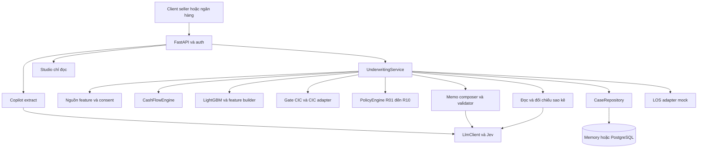

# Kiến trúc phần mềm Riverbank

SAD xác định thành phần, trách nhiệm, persistence và ranh giới tích hợp của Riverbank. Thiết kế database mini theo [DBML](../database/riverbank-mini.dbml) và [DATA](DATA.md), chưa có migration hay backend thực thi.

## Thành phần hệ thống

Sơ đồ là quan hệ thành phần. Thứ tự thực thi và nhánh gap 0 do service quyết định. Frontend dùng Next.js, gồm các luồng seller, lender portal và studio, giao tiếp qua HTTPS API.

## Thiết kế và ranh giới

Router xử lý HTTP, xác thực/role và schema. Service điều phối nghiệp vụ. CashFlowEngine, PolicyEngine và inference PD tính số. Adapter bọc nguồn feature, CIC, persistence và LOS để test không gọi mạng.

`_assess` tạo snapshot và run mới, emit evidence, chạy phần có điều kiện rồi compose memo. Điều phối phải tường minh, kiểm soát thứ tự và điều kiện gọi model. Text-to-SQL và Monitor thuộc thiết kế mở rộng.

LLM đi qua `api/llm.py`, prompt được nạp qua `api/prompts.py`. Memo nhận kết quả/evidence, có validator và template fallback. LLM không điều chỉnh kết quả engine. CIC gate tách khỏi adapter tra CIC. OCR/classifier là phụ thuộc có điều kiện, lỗi không được biến thành dữ liệu hợp lệ.

## Persistence và tính nhất quán

Repository được thiết kế có adapter Memory/Postgres, chưa được triển khai. Schema lưu hồ sơ ở applications, optimistic concurrency dùng version_no. Snapshot feature/payout nằm trong assessment_runs.input_snapshot. Counter tạo run mới trước khi lưu quyết định hợp lệ. Run COMPLETED, evidence, quyết định cuối và audit application_events phải được giữ bất biến.

Evidence có payload/hash và được kiểm lại khi dùng. Handoff có state/hash/key, tạo cùng transaction quyết định và retry gói đóng băng, không rollback quyết định chỉ vì LOS lỗi. DBML chưa có lease hoặc request key/hash cho tạo application/decision. Cần chốt cơ chế idempotency và claim/recovery trước hoàn thiện repository, không coi các cơ chế đó đã có sẵn trong schema.

Mini có một quyết định cuối cho một application, không có bảng version điều khoản ACTIVE/SUPERSEDED. P7 là extension cần schema riêng. Tiền SQL NUMERIC(18,2), application dùng Decimal và tiền JSONB dùng chuỗi decimal. Không dùng float cho tiền, không suy định dạng HTTP từ SQL.

## Triển khai

Kiến trúc triển khai dự kiến: API container sau Caddy trên EC2 arm64, RDS PostgreSQL, S3, Secrets Manager qua IAM role, GitHub Actions CI/deploy. application_documents cần object_key ổn định, object_version hoặc key không ghi đè, content_hash và media_type. File metadata lưu DB, không lưu URL presigned làm địa chỉ gốc. Storage adapter, quyền và retention cần chốt trước upload.

Thiết lập runbook triển khai, rollback và quản lý secrets trước thao tác vận hành. Không chép secrets hoặc địa chỉ/mật khẩu của máy teammate vào source. Workflow deploy phải có điều kiện kích hoạt và phân quyền rõ.

## Quyết định kiến trúc

| Quyết định | Lý do | Giới hạn |
|---|---|---|
| Code tính, LLM viết | Tái lập số và kiểm toán | Cần validator trước phát hành |
| Một Postgres cho feature và workflow | Giảm thành phần vận hành | Vẫn cần scope và phân quyền dữ liệu |
| Adapter cho nguồn ngoài | Test offline, thay mock bằng ngân hàng | Mock không chứng minh tích hợp thật |
| Human decision | Giữ trách nhiệm tín dụng ở ngân hàng | UI phải thể hiện đề xuất khác quyết định |
| Policy và golden có version/hash | Truy vết kết quả | Loader phải kiểm cả hash và xác nhận policy |

Ưu tiên theo NEXT_STEPS: migration/transaction theo schema mini, policy approval trước nạp rule, benchmark khi nghiệm thu latency/chi phí. Version điều khoản sau quyết định và P7 thuộc backlog mở rộng.
