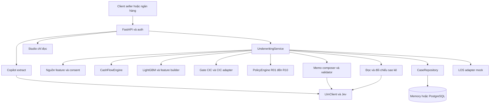

# Kiến trúc phần mềm Riverbank

SAD xác định thành phần, trách nhiệm, persistence và ranh giới tích hợp của Riverbank. Tham khảo [TDD](SAD.md) và [kiến trúc AWS](SAD.md).

## Thành phần hệ thống

Sơ đồ là quan hệ thành phần. Thứ tự thực thi và nhánh gap 0 do service quyết định. Frontend dùng Next.js, gồm các luồng seller, lender portal và studio, giao tiếp qua HTTPS API.

## Thiết kế và ranh giới

Router xử lý HTTP, xác thực/role và schema. Service điều phối nghiệp vụ. CashFlowEngine, PolicyEngine và inference PD tính số. Adapter bọc nguồn feature, CIC, persistence và LOS để test không gọi mạng.

`_assess` tạo snapshot và run mới, emit evidence, chạy phần có điều kiện rồi compose memo. Điều phối phải tường minh, kiểm soát thứ tự và điều kiện gọi model. Text-to-SQL và Monitor thuộc thiết kế mở rộng.

LLM đi qua `api/llm.py`, prompt được nạp qua `api/prompts.py`. Memo nhận kết quả/evidence, có validator và template fallback. LLM không điều chỉnh kết quả engine. CIC gate tách khỏi adapter tra CIC. OCR/classifier là phụ thuộc có điều kiện, lỗi không được biến thành dữ liệu hợp lệ.

## Persistence và tính nhất quán

`CaseRepository` có Memory/Postgres implementation. `cases.version` dùng optimistic concurrency. Assessment run, document, evidence và event giữ lịch sử theo case/run. Idempotency gắn phạm vi seller cho tạo case và gắn quyết định theo implementation. Counter tạo run mới trước khi lưu quyết định hợp lệ.

Evidence có payload/hash và được kiểm lại khi dùng. Handoff có trạng thái/lease/hash riêng để retry an toàn, quyết định không rollback chỉ vì LOS lỗi. Version điều khoản dùng lifecycle `ACTIVE/SUPERSEDED`, giữ riêng với run thẩm định và version khóa ghi.

## Triển khai

Kiến trúc triển khai: API container sau Caddy trên EC2 arm64, RDS PostgreSQL, S3 cho raw ETL, Secrets Manager qua IAM role, GitHub Actions CI/deploy. Sao kê upload được nhận trực tiếp qua API. Việc lưu file gốc lên object storage phụ thuộc chính sách retention đã chốt với ngân hàng.

Hạ tầng đã bổ sung Cognito User Pool (Code + PKCE, MFA), ECR và GitHub OIDC/SSM; CloudFormation quản lý identity/roles/registry/deployment document. Kafka KRaft một broker và Redis ACL/AOF chạy cùng EC2, chỉ trong mạng Docker internal, credential riêng ở Secrets Manager. Runtime và deploy có role riêng với permissions boundary. GitHub OIDC là danh tính pipeline, tách với Cognito là danh tính người dùng. Chi tiết cấu hình và bằng chứng thực tế ở README; dựng pool/groups không thay phần JWT/ownership của backend hoặc callback của frontend.

Đây vẫn là triển khai một máy cho ngân sách credit; chưa có EKS, HA hoặc pipeline nghiệp vụ outbox/consumer. Kafka/Redis được kiểm bằng dữ liệu giả, không kích hoạt worker/model hoặc chuyển dữ liệu nhạy cảm sang đó. CloudWatch/SNS theo dõi host, services và HTTPS readiness. Thay đổi hạ tầng không tự thay contract API hoặc chính sách tín dụng.

Thiết lập runbook triển khai, rollback và quản lý secrets trước thao tác vận hành. Không chép secrets hoặc địa chỉ/mật khẩu của máy teammate vào source. Workflow deploy phải có điều kiện kích hoạt và phân quyền rõ.

## Quyết định kiến trúc

| Quyết định | Lý do | Giới hạn |
|---|---|---|
| Code tính, LLM viết | Tái lập số và kiểm toán | Cần validator trước phát hành |
| Một Postgres cho feature và workflow | Giảm thành phần vận hành | Vẫn cần scope và phân quyền dữ liệu |
| Adapter cho nguồn ngoài | Test offline, thay mock bằng ngân hàng | Mock không chứng minh tích hợp thật |
| Human decision | Giữ trách nhiệm tín dụng ở ngân hàng | UI phải thể hiện đề xuất khác quyết định |
| Policy và golden có version/hash | Truy vết kết quả | Loader phải kiểm cả hash và xác nhận policy |

Mở rộng ưu tiên theo dependency trong NEXT_STEPS: version điều khoản trước P7, policy approval trước nạp rule và benchmark khi nghiệm thu latency/chi phí.
