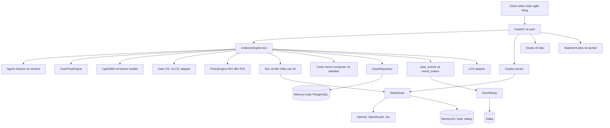

# Kiến trúc phần mềm Riverbank

SAD xác định thành phần, trách nhiệm, persistence và ranh giới tích hợp của Riverbank. Contract quan sát được nằm trong [API.md](API.md), [DATA.md](DATA.md) và [SRS.md](SRS.md).

## Thành phần hệ thống

Sơ đồ là quan hệ thành phần. Thứ tự thực thi và nhánh gap 0 do service quyết định. Frontend dùng Next.js, gồm các luồng seller, lender portal và studio, giao tiếp qua HTTPS API.

## Thiết kế và ranh giới

Router xử lý HTTP, xác thực/role và schema. Service điều phối nghiệp vụ. CashFlowEngine, PolicyEngine và inference PD tính số. Adapter bọc nguồn feature, CIC, persistence và LOS để test không gọi mạng.

Luồng assess tạo feature snapshot và run mới, emit evidence, chạy phần có điều kiện rồi compose memo bằng code. Điều phối phải tường minh, kiểm soát thứ tự và điều kiện gọi model. Hồ sơ chờ R05 phải hoãn gate/CIC đến sau sao kê. Text-to-SQL và Monitor thuộc thiết kế mở rộng.

Mọi OpenAI, OpenRouter và Jev call đi qua `ModelGate`: giới hạn song song, call/phút và circuit breaker theo provider. State dùng MemoryKV khi local, Valkey khi cần shared limit. Store gate lỗi thì fail open có log; caller vẫn chịu trách nhiệm timeout/fallback. LightGBM chạy trong process và không qua gate.

D09/D10 nhận facts/evidence đã khóa, do `CodeMemoWriter` ghép câu với semantic frame rồi validator kiểm chủ thể, quan hệ, vai trò số, đơn vị và từ cấm. Không fallback sang LLM. CIC gate tách khỏi adapter tra CIC. OCR/classifier là phụ thuộc có điều kiện; lỗi không được biến thành dữ liệu hợp lệ.

## Persistence và tính nhất quán

Repository contract có mode Memory cho test và PostgreSQL cho persistence. `cases.version` dùng optimistic concurrency. Assessment run, document, evidence và event giữ lịch sử theo case/run. Idempotency gắn phạm vi seller cho tạo case và theo actor/case cho quyết định. Counter tạo run mới trước khi lưu quyết định hợp lệ.

`case_events` và `event_outbox` được INSERT cùng transaction. Relay publish `riverbank.case-events` với key `case_id`, chỉ đánh dấu published sau khi broker xác nhận. Delivery là at-least-once nên consumer phải deduplicate theo `event_id`. Kafka ngừng không được chặn request thẩm định.

Upload sao kê nền dùng job có lease và `FOR UPDATE SKIP LOCKED`. Lỗi 5xx có thể retry, 4xx kết thúc; E8 gắn `job_id` để retry không ghi hai lần. File tạm phải được xóa sau khi job kết thúc theo retention đã chốt.

Evidence có payload/hash và được kiểm lại khi dùng. Handoff có trạng thái/lease/hash riêng để retry an toàn, quyết định không rollback chỉ vì LOS lỗi. Version điều khoản dùng lifecycle `ACTIVE/SUPERSEDED`, giữ riêng với run thẩm định và version khóa ghi.

## Triển khai

Kiến trúc triển khai: API container sau Caddy trên EC2 arm64, RDS PostgreSQL, S3 cho raw ETL, Secrets Manager qua IAM role, GitHub Actions CI/deploy. Sao kê upload được nhận trực tiếp qua API. Việc lưu file gốc lên object storage phụ thuộc chính sách retention đã chốt với ngân hàng.

Thiết lập runbook triển khai, rollback và quản lý secrets trước thao tác vận hành. Không chép secrets hoặc địa chỉ/mật khẩu của máy teammate vào source. Workflow deploy phải có điều kiện kích hoạt và phân quyền rõ.

## Quyết định kiến trúc

| Quyết định | Lý do | Giới hạn |
|---|---|---|
| Code tính và viết D09/D10 | Tái lập cả số lẫn vai trò ngữ nghĩa | Cần semantic validator trước phát hành |
| Một Postgres cho feature và workflow | Giảm thành phần vận hành | Vẫn cần scope và phân quyền dữ liệu |
| Adapter cho nguồn ngoài | Test offline, thay mock bằng ngân hàng | Mock không chứng minh tích hợp thật |
| Transactional outbox | Không mất event giữa DB commit và publish | Consumer phải idempotent |
| ModelGate dùng Valkey tùy mode | Chia sẻ limit giữa worker/container | Memory mode chỉ giới hạn theo process |
| Human decision | Giữ trách nhiệm tín dụng ở ngân hàng | UI phải thể hiện đề xuất khác quyết định |
| Policy và golden có version/hash | Truy vết kết quả | Loader phải kiểm cả hash và xác nhận policy |

Mở rộng ưu tiên theo dependency trong NEXT_STEPS: version điều khoản trước P7, policy approval trước nạp rule và benchmark khi nghiệm thu latency/chi phí.
