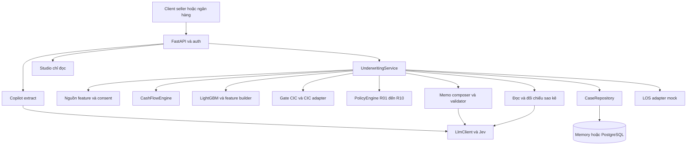

# Kiến trúc phần mềm Riverbank

SAD xác định thành phần, trách nhiệm, persistence và ranh giới tích hợp của Riverbank. Tham khảo [TDD](SAD.md) và [kiến trúc AWS](SAD.md).

## Thành phần hệ thống

Sơ đồ là quan hệ thành phần. Thứ tự thực thi và nhánh gap 0 do service quyết định. Frontend dùng Next.js, gồm các luồng seller, lender portal và studio, giao tiếp qua HTTPS API.

## Thiết kế và ranh giới

Router xử lý HTTP, xác thực/role và schema. Service điều phối nghiệp vụ. CashFlowEngine, PolicyEngine và inference PD tính số. Adapter bọc nguồn feature, CIC, persistence và LOS để test không gọi mạng.

Định hướng xác thực là OpenID Connect trên OAuth 2.0: client dùng Authorization Code với PKCE S256, API kiểm access token và xác định quyền từ nguồn server đáng tin cậy. Contract nội bộ tách verifier và nguồn grant theo issuer/subject. Schema mini chọn DB làm nguồn quyền với `auth_identities`, `identity_roles`, `seller_access_grants` và `authorization_events`; ownership grant chỉ gắn role seller với shop của người vay. Underwriter là nhân sự ngân hàng trên lending platform, dùng role cấp nền tảng mini một ngân hàng và không cần grant shop. Quyết định lưu identity người ngân hàng cùng assignment underwriter đã dùng, có CHECK/FK tổ hợp ràng buộc đúng actor/role. Một seller trong mini là một shop, ánh xạ `shop_id` qua `external_shop_ref` phía server. Quyền và thu hồi được đọc lại mỗi request; ghi quyết định phải tuần tự hóa với disable/revoke. Chi tiết tại [thiết kế auth database](../database/README.md). Chưa có migration, adapter thực hay endpoint nghiệp vụ áp dụng contract. Provider, provisioning/control plane, session và contract token còn phải chốt; chưa có tích hợp auth. Consent truy cập dữ liệu sàn được kiểm riêng.

`_assess` tạo snapshot và run mới, emit evidence, chạy phần có điều kiện rồi compose memo. Điều phối phải tường minh, kiểm soát thứ tự và điều kiện gọi model. Text-to-SQL và Monitor thuộc thiết kế mở rộng.

LLM đi qua `api/llm.py`, prompt được nạp qua `api/prompts.py`. Memo nhận kết quả/evidence, có validator và template fallback. LLM không điều chỉnh kết quả engine. CIC gate tách khỏi adapter tra CIC. OCR/classifier là phụ thuộc có điều kiện, lỗi không được biến thành dữ liệu hợp lệ.

## Persistence và tính nhất quán

Code hiện có repository in-memory cho tạo/đọc case và idempotency cùng event ban đầu; chưa có PostgreSQL, migration hoặc optimistic concurrency update. Thiết kế đích dùng `applications.version_no` làm khóa ghi, ánh xạ từ API `expected_version` và tên `cases.version` trong contract cũ. Assessment run, document, evidence và event phải giữ lịch sử theo application/run. Idempotency tạo case gắn seller/shop; quyết định có phạm vi thao tác riêng theo contract. Counter phải tạo run và version điều khoản mới trước khi lưu quyết định hợp lệ. Thống nhất schema trước business migration theo CORE-01.24, hiện thực ở CORE-01.07 và VER-01.

Evidence có payload/hash và được kiểm lại khi dùng. Handoff có trạng thái/lease/hash riêng để retry an toàn, quyết định không rollback chỉ vì LOS lỗi. Version điều khoản dùng lifecycle `ACTIVE/SUPERSEDED`, giữ riêng với run thẩm định và version khóa ghi.

## Triển khai

Kiến trúc triển khai: API container sau Caddy trên EC2 arm64, RDS PostgreSQL, S3 cho raw ETL, Secrets Manager qua IAM role, GitHub Actions CI/deploy. Sao kê upload được nhận trực tiếp qua API. Việc lưu file gốc lên object storage phụ thuộc chính sách retention đã chốt với ngân hàng.

Thiết lập runbook triển khai, rollback và quản lý secrets trước thao tác vận hành. Không chép secrets hoặc địa chỉ/mật khẩu của máy teammate vào source. Workflow deploy phải có điều kiện kích hoạt và phân quyền rõ.

## Quyết định kiến trúc

| Quyết định | Lý do | Giới hạn |
|---|---|---|
| Code tính, LLM viết | Tái lập số và kiểm toán | Cần validator trước phát hành |
| Một Postgres cho feature và workflow | Giảm thành phần vận hành | Vẫn cần scope và phân quyền dữ liệu |
| Adapter cho nguồn ngoài | Test offline, thay mock bằng ngân hàng | Mock không chứng minh tích hợp thật |
| Human decision | Giữ trách nhiệm tín dụng ở ngân hàng | UI phải thể hiện đề xuất khác quyết định |
| Policy và golden có version/hash | Truy vết kết quả | Loader phải kiểm cả hash và xác nhận policy |

Mở rộng ưu tiên theo dependency trong NEXT_STEPS: version điều khoản trước P7, policy approval trước nạp rule và benchmark khi nghiệm thu latency/chi phí.
